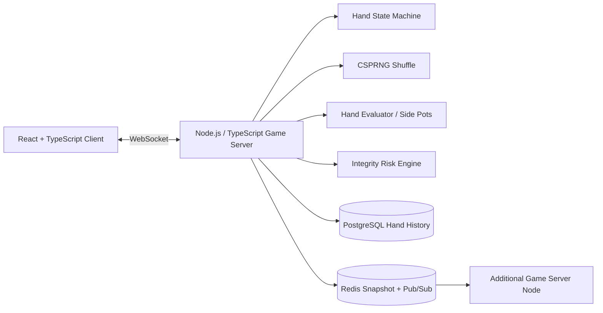

# Hold'em Realtime Integrity Lab

A portfolio-grade prototype of a **real-time Texas Hold'em platform core** built to demonstrate game-server architecture, deterministic domain logic, cryptographically secure shuffling, WebSocket event delivery, persistence boundaries, and anti-abuse controls.

> This is a public-safe engineering prototype, not a production gambling service. It uses synthetic players and no real-money flow. The goal is to make architecture and implementation choices inspectable and testable.

## What this project demonstrates

- TypeScript + Node.js game server
- WebSocket table events
- explicit hand state machine
- CSPRNG-backed Fisher–Yates shuffle
- side-pot calculation
- 5/7-card hand evaluation
- PostgreSQL hand/event persistence boundary
- Redis cross-node event fan-out design
- React + TypeScript browser client
- explainable anti-bot / multi-account / collusion-risk signals
- unit tests and CI

## Architecture



## Hand lifecycle

`WAITING → PREFLOP → FLOP → TURN → RIVER → SHOWDOWN → COMPLETE`

The server is authoritative. Clients submit intents; the server owns deck order, phase transitions, board state, and public table events.

## Fair shuffle

`server/src/domain/shuffle.ts` uses Node's `crypto.randomInt()` inside Fisher–Yates instead of `Math.random()`. Hidden deck order is never sent to the browser. A SHA-256 audit hash is generated for correlation with server-side hand history.

## Integrity controls

`server/src/integrity/risk.ts` produces an explainable 0–100 review score from synthetic telemetry such as:

- unusually consistent action timing
- multiple accounts sharing a device
- repeated IP sharing
- repeated table overlap between the same players
- highly synchronized betting behavior

These are **review signals, not automatic guilt determinations**. Production anti-collusion requires richer longitudinal data, false-positive controls, privacy review, graph analysis, and human investigation.

## Data responsibilities

- **PostgreSQL:** durable hand/event history
- **Redis:** ephemeral table snapshot + cross-node fan-out
- **Game server memory:** active authoritative hand state

This prototype intentionally does not implement real-money settlement.

## Project structure

```text
.
├── client/                 # React + TypeScript demo UI
├── server/
│   ├── src/domain/         # cards, shuffle, state machine, pots, evaluator
│   ├── src/integrity/      # anti-abuse risk signals
│   ├── src/infra/          # Postgres / Redis adapter
│   └── tests/              # domain tests
├── docs/
├── docker-compose.yml
└── .github/workflows/ci.yml
```

## What this proves — and what it does not

**Demonstrated here**

- ability to model a real-time card game as server-authoritative state
- TypeScript/Node/WebSocket implementation
- CSPRNG shuffle implementation
- relational + Redis architecture boundaries
- React/TypeScript event-driven client
- security/fraud thinking applied to game integrity

**Not claimed**

- prior production launch of a poker server
- certification by GLI/iTech Labs
- real-money wallet or payment processing
- production-scale concurrency numbers without measured infrastructure results
- regulatory approval

See `docs/architecture.md` and `docs/production-gaps.md` for design decisions and remaining production work.

> Repository note: this code currently lives in the pre-existing `sylee_portfolio` repository. Renaming the repository to `holdem-realtime-integrity-lab` will make the public URL match the project title.